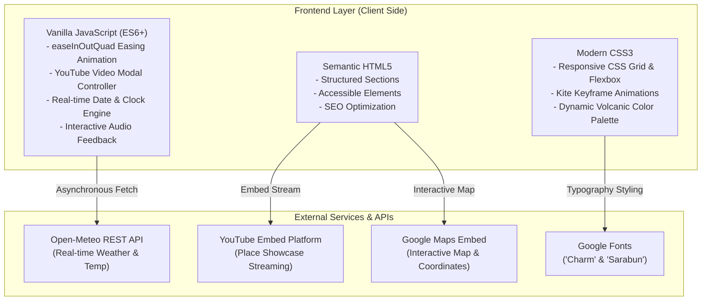

# <div align="center">🌋 ฮักเมืองบุรีรัมย์ (Travel Buriram) ⚡</div>

<div align="center">

*สัมผัสมนต์ขลังปราสาทหินพันปี ยลวิถีดินแดนภูเขาไฟ สู่มหานครแห่งการท่องเที่ยวและเมืองกีฬาโลก*

[](https://github.com/sanior09/Travel-Buriram/stargazers)
[](https://github.com/sanior09/Travel-Buriram/network/members)
[](LICENSE)
[](https://developer.mozilla.org/en-US/docs/Web/HTML)
[](https://developer.mozilla.org/en-US/docs/Web/CSS)
[](https://developer.mozilla.org/en-US/docs/Web/JavaScript)
[](https://open-meteo.com/)

<br/>

[🌐 ชมเว็บไซต์ตัวอย่าง (Live Demo)](https://sanior09.github.io/Travel-Buriram/) • 
[✨ ฟีเจอร์เด่น](#-ฟีเจอร์เด่นและไฮไลท์ของระบบ) • 
[🗺️ 20 สถานที่ยอดนิยม](#-สถานที่ท่องเที่ยวยอดนิยม-20-แห่ง) • 
[🚀 เริ่มต้นใช้งาน](#-วิธีการติดตั้งและเปิดใช้งานในเครื่อง-getting-started) • 
[📌 โครงสร้างโปรเจกต์](#-โครงสร้างไฟล์ในโปรเจกต์)

</div>

---

## 📖 เกี่ยวกับโปรเจกต์ (About Project)

**"ฮักเมืองบุรีรัมย์ (Travel Buriram)"** เป็นเว็บแอปพลิเคชันแนะนำการท่องเที่ยวเชิงวัฒนธรรม ธรณีวิทยา และกีฬาระดับโลก ที่รวบรวมข้อมูลสถานที่สำคัญ แหล่งโบราณคดีขอมโบราณ ภูเขาไฟที่ดับสนิท อาหารสตรีทฟู้ดชื่อดัง ผลิตภัณฑ์ผ้าไหมภูเขาไฟ ตลอดจนงานประเพณีอันยิ่งใหญ่ของจังหวัดบุรีรัมย์ เมืองแห่งความภาคภูมิใจในแถบอีสานใต้

ตัวเว็บถูกออกแบบด้วยแนวคิด **Modern Isan & Sport Heritage Experience** นำเสนอมนต์เสน่ห์ของปราสาทหินทรายและพลังแห่งเมืองกีฬา ผ่านงานดีไซน์ร่วมสมัยที่ผสานแอนิเมชันลูกเล่นว่าวแอกลอยลม, ระบบดึงสภาพอากาศสดจากสถานีพยากรณ์แบบเรียลไทม์, โมดอลวิดีโอแนะนำสถานที่ และระบบนำทางที่นุ่มนวล รองรับการแสดงผลทุกหน้าจออย่างสมบูรณ์แบบ

---

## ✨ ฟีเจอร์เด่นและไฮไลท์ของระบบ

```
   ┌────────────────────────────────────────────────────────────────────────┐
   │                     ⚡ TRAVEL BURIRAM CORE SYSTEM                      │
   ├──────────────────┬──────────────────┬──────────────────────────────────┤
   │ 🌤️ Live Weather  │ ⏰ Thai Clock    │ 🪁 Animated Kite FX              │
   │ ดึงสภาพอากาศสด   │ วัน-เวลาไทย      │ แอนิเมชันว่าวแอกโบราณ 15 ตัว     │
   │ จาก Open-Meteo   │ ปฏิทินไทย พ.ศ.   │ ลอยล่องจำลองบรรยากาศงานเทศกาล    │
   ├──────────────────┼──────────────────┼──────────────────────────────────┤
   │ 🎬 Video Modals  │ 🗺️ Google Maps   │ 🌊 Easing Smooth Navigation      │
   │ ป๊อปอัป YouTube  │ แผนที่แบบโต้ตอบ  │ เลื่อนนุ่มนวลด้วย easeInOutQuad  │
   │ ชมคลิป 20 แหล่ง  │ พร้อมปักหมุด GPS │ พร้อม Interactive Audio Feedback │
   └──────────────────┴──────────────────┴──────────────────────────────────┘
```

### 1. 🌤️ ระบบตรวจวัดสภาพอากาศสด (Live Weather API)
- เชื่อมต่อกับ **Open-Meteo Forecast API** แบบเรียลไทม์ ณ พิกัดใจกลางเมืองบุรีรัมย์ (`14.9930° N, 103.1029° E`)
- แปลงรหัสสภาพอากาศ WMO Weather Code เป็นภาษาไทย พร้อมไอคอนสภาพอากาศแบบไดนามิก (แดดจัด, มีเมฆ, ฝนตก, พายุฟ้าคะนอง)
- แสดงอุณหภูมิปัจจุบันแบบองศาเซลเซียส พร้อมประมวลผลทันทีเมื่อเปิดหน้าเว็บ

### 2. 🕒 นาฬิกาและปฏิทินไทยเรียลไทม์ (Realtime Clock & Calendar)
- แสดงวันในสัปดาห์ วันที่ เดือนภาษาไทย และปีพุทธศักราช (พ.ศ.) คำนวณแบบ Real-time
- แสดงนาฬิกาดิจิทัลนับเวลาแบบวินาทีต่อวินาที (Digital Live Clock)

### 3. 🪁 แอนิเมชันว่าวแอกลอยลม (Animated Kite Floating FX)
- สร้างบรรยากาศเอกลักษณ์ของเมืองบุรีรัมย์ผ่านแอนิเมชัน CSS Keyframes จำลองฝูงว่าวแอกโบราณ 15 ตัว ลอยผ่านหน้าจอด้วยความเร็วและทิศทางที่แตกต่างกัน
- แถบตัววิ่งข่าวสาร (News Ticker) ต้อนรับนักท่องเที่ยวด้วยคำขวัญเมืองบุรีรัมย์ตลอดการใช้งาน

### 4. 🎥 ระบบวิดีโอป๊อปอัปแบบฝัง (Interactive YouTube Modal)
- รองรับการเปิดชมวิดีโอแนะนำสถานที่ท่องเที่ยวความคมชัดสูงผ่าน Modal Popup ได้ทันทีโดยไม่ต้องเปลี่ยนหน้า
- ปลอดภัยและประหยัดการประมวลผล: ระบบตัดการทำงานของเครื่องเล่นและเคลียร์ URL วิดีโอทันทีเมื่อกดปิดหน้าต่าง

### 5. 🗺️ แผนที่พิกัดดาวเทียม & คู่มือการเดินทาง 4 มิติ
- ฝังแผนที่ **Interactive Google Maps** ช่วยให้นักท่องเที่ยวค้นหาพิกัดและเส้นทางได้อย่างแม่นยำ
- แนะนำข้อมูลการเดินทางครบวงจรทั้ง 4 ช่องทาง: รถยนต์ส่วนตัว, รถโดยสารประจำทาง (บขส./นครชัยแอร์), รถไฟสายอีสานใต้ และเที่ยวบินตรงสู่สนามบินบุรีรัมย์ (BFV)

### 6. 🌊 การเลื่อนหน้าจอที่นุ่มนวลเป็นพิเศษ (Smooth Scroll with Easing)
- ใช้อัลกอริทึม **Ease-In-Out Quad** (`easeInOutQuad`) ควบคุมแอนิเมชันการ Scroll ด้วย `requestAnimationFrame` เป็นเวลา 1.2 วินาที
- คำนวณหักลบ Offset ความสูงของแถบ Sticky Navbar อัตโนมัติ ป้องกันไม่ให้แถบเมนูบังหัวข้อ
- ระบบเสียงคลิกโต้ตอบ (**Audio Feedback**) เสริมประสบการณ์การใช้งานที่สมจริง

---

## 🗺️ สถานที่ท่องเที่ยวยอดนิยม 20 แห่ง

| ลำดับ | สถานที่ | ไฮไลท์สำคัญ | วิดีโอแนะนำ |
| :---: | :--- | :--- | :---: |
| **01** | **อุทยานประวัติศาสตร์พนมรุ้ง** | ปราสาทหินทรายสีชมพูบนยอดภูเขาไฟ ชมปรากฏการณ์ดวงอาทิตย์ขึ้นลอด 15 ช่องประตู | `ชมได้ในเว็บ` |
| **02** | **ปราสาทเมืองต่ำ** | สถาปัตยกรรมขอมโบราณที่มีสระน้ำบารายล้อมรอบ 4 ทิศ และพญานาค 5 เศียรที่สมบูรณ์ที่สุด | `ชมได้ในเว็บ` |
| **03** | **สนามช้างอารีนา (Chang Arena)** | สนามฟุตบอลมาตรฐานฟีฟ่าระดับโลก รังเหย้าของสโมสรบุรีรัมย์ ยูไนเต็ด "ปราสาทสายฟ้า" | `ชมได้ในเว็บ` |
| **04** | **วนอุทยานเขากระโดง** | ปากปล่องภูเขาไฟที่ดับสนิท สะพานแขวนลาวา และสักการะพระสุภัทรบพิตรบนยอดเขา | `ชมได้ในเว็บ` |
| **05** | **อุทยานไม้ดอกเพลาเพลิน** | แหล่งท่องเที่ยวเชิงเรียนรู้และสวนจัดแสดงไม้ดอกเมืองหนาวในโรงเรือนตลอดทั้งปี | `ชมได้ในเว็บ` |
| **06** | **วัดเขาอังคาร** | พุทธสถานบนยอดภูเขาไฟอังคาร โดดเด่นด้วยโบสถ์ 3 ยอดและใบเสมาหินบะซอลต์โบราณ | `ชมได้ในเว็บ` |
| **07** | **วัดป่าเขาน้อย** | สถานปฏิบัติธรรมสายพระป่ากรรมฐาน มีพระบรมธาตุเจดีย์ศรีสุวจคุณานุสรณ์ถอดแบบจากพนมรุ้ง | `ชมได้ในเว็บ` |
| **08** | **ศาลหลักเมืองบุรีรัมย์** | สิ่งศักดิ์สิทธิ์คู่บ้านคู่เมือง สถาปัตยกรรมขอมประยุกต์สวยงามตระการตา | `ชมได้ในเว็บ` |
| **09** | **ถนนคนเดินเซราะกราว** | ตลาดวัฒนธรรมยามเย็นหน้าจวนผู้ว่าฯ แหล่งรวมอาหารพื้นบ้าน ดนตรีสด และสินค้า OTOP | `ชมได้ในเว็บ` |
| **10** | **อ่างเก็บน้ำห้วยจระเข้มาก** | ทะเลสาบน้ำจืดขนาดใหญ่ แหล่งดูนกน้ำนานาพันธุ์ และจุดชมวิวพระอาทิตย์ตกดินสุดโรแมนติก | `ชมได้ในเว็บ` |
| **11** | **หมู่บ้านท่องเที่ยววิถีไหมสนวนนอก** | หมู่บ้านท่องเที่ยวเชิงวัฒนธรรม สัมผัสวิถีการปลูกหม่อน เลี้ยงไหม และทอผ้าไหมมัดหมี่ | `ชมได้ในเว็บ` |
| **12** | **ศูนย์อนุรักษ์นกกระเรียนพันธุ์ไทย** | แหล่งเรียนรู้และฟื้นฟูประชากรนกกระเรียนพันธุ์ไทยที่เคยสูญพันธุ์ไปจากธรรมชาติ | `ชมได้ในเว็บ` |
| **13** | **พระบรมราชานุสาวรีย์ รัชกาลที่ 1** | อนุสาวรีย์ปฐมกษัตริย์แห่งราชวงศ์จักรี ผู้ทรงรวบรวมและก่อตั้งเมืองแปะหรือเมืองบุรีรัมย์ | `ชมได้ในเว็บ` |
| **14** | **สนามช้าง อินเตอร์เนชั่นแนล เซอร์กิต** | สนามแข่งขันมอเตอร์สปอร์ตมาตรฐาน FIA Grade 1 / FIM Grade A เจ้าภาพศึก MotoGP | `ชมได้ในเว็บ` |
| **15** | **เขื่อนลำนางรอง** | อ่างเก็บน้ำขนาดใหญ่ริมเทือกเขาพนมดงรัก มีหาดทรายเทียมและซุ้มอาหารริมน้ำ | `ชมได้ในเว็บ` |
| **16** | **หาดปราสาททอง** | ทะเลสาบน้ำจืดแห่งอำเภอหนองกี่ กิจกรรมทางน้ำครบครัน พักผ่อนรับลมธรรมชาติ | `ชมได้ในเว็บ` |
| **17** | **วัดเกาะแก้วธุดงคสถาน** | พุทธสถานบนเกาะกลางน้ำ ประดิษฐานมหาธาตุรัตนเจดีย์ศรีบุรีรัมย์บรรจุพระบรมสารีริกธาตุ | `ชมได้ในเว็บ` |
| **18** | **ปราสาทหนองหงส์** | โบราณสถานขอมขนาดกะทัดรัด ประกอบด้วยปรางค์อิฐ 3 องค์ ศิลปะแบบบาปวน | `ชมได้ในเว็บ` |
| **19** | **สวนคุณปู่ บุรีรัมย์** | แหล่งท่องเที่ยวเชิงเกษตรอินทรีย์ สะพานไม้ไผ่ทอดยาวกลางทุ่งนาและคาเฟ่วิวธรรมชาติ | `ชมได้ในเว็บ` |
| **20** | **วัดกลางพระอารามหลวง** | วัดคู่เมืองเก่าแก่ มีสระน้ำโบราณศักดิ์สิทธิ์ที่ใช้ประกอบพระราชพิธีบรมราชาภิเษก | `ชมได้ในเว็บ` |

---

## 🍲 หมวดหมู่เนื้อหาอื่น ๆ ภายในเว็บไซต์

- **🍜 ของกินห้ามพลาดบุรีรัมย์ (Local Street Food):** ลูกชิ้นยืนกินสูตรน้ำจิ้มพริกเผาหน้าสถานีรถไฟ, ขาหมูนางรองเนื้อนุ่มละมุน, กุ้งจ่อมสูตรอีสานใต้
- **🛍️ ของฝากขึ้นชื่อ (Local Souvenirs):** ผ้าภูอัคนีย้อมดินภูเขาไฟแท้, กุ้งจ่อมประโคนชัย, กระยาสารทสูตรโบราณ
- **🎉 เทศกาลและงานประเพณี (Festivals & Events):** งานประเพณีขึ้นเขาพนมรุ้ง, งานแข่งขันเรือยาวชิงถ้วยพระราชทานฯ ลำน้ำมูลสตึก, งานมหกรรมว่าวอีสานบุรีรัมย์
- **🚗 ข้อมูลการเดินทาง (Transportation Guide):** รายละเอียดเส้นทางขับรถ, ตารางเดินรถไฟสถานีบุรีรัมย์, รถโดยสาร บขส./นครชัยแอร์, เที่ยวบินพาณิชย์ตรง

---

## 🛠️ โครงสร้างเทคโนโลยี (Tech Stack)



---

## 📁 โครงสร้างไฟล์ในโปรเจกต์

```text
Travel-Buriram/
├── .github/
│   └── workflows/
│       └── deploy.yml        # CI/CD Automation สำหรับ Publish ขึ้น GitHub Pages อัตโนมัติ
├── .gitignore                # กำหนดรายการไฟล์และโฟลเดอร์ที่ไม่ต้องการบันทึกลง Git
├── LICENSE                   # สัญญาอนุญาตการใช้งานแบบ Open-Source (MIT License)
├── README.md                 # เอกสารแนะนำและข้อมูลโปรเจกต์ฉบับสมบูรณ์ (เอกสารนี้)
├── index.html                # โครงสร้างหน้าเว็บหลัก รวบรวม 20 สถานที่ท่องเที่ยวและระบบต่างๆ
├── style.css                 # สไตล์ชีท ตกแต่งดีไซน์ แอนิเมชันว่าวแอก และ Responsive UI
└── script.js                 # ระบบคำนวณ Easing, นาฬิกาไทย, Weather API, Modal Controller
```

---

## 🚀 วิธีการติดตั้งและเปิดใช้งานในเครื่อง (Getting Started)

ท่านสามารถดาวน์โหลดและรันโปรเจกต์บนเครื่องคอมพิวเตอร์ส่วนบุคคลได้โดยง่าย โดยไม่ต้องติดตั้งเฟรมเวิร์กขนาดใหญ่:

### 1. โคลนคลังโค้ด (Clone Repository)
```bash
git clone https://github.com/sanior09/Travel-Buriram.git
cd Travel-Buriram
```

### 2. เปิดใช้งานเว็บไซต์ (Running Locally)

เลือกวิธีใดวิธีหนึ่งตามความสะดวกของท่าน:

* **วิธีที่ 1 (แนะนำสำหรับ VS Code):**  
  ติดตั้ง Extension [Live Server](https://marketplace.visualstudio.com/items?itemName=ritwickdey.LiveServer) จากนั้นคลิกขวาที่ไฟล์ `index.html` แล้วเลือก **"Open with Live Server"**

* **วิธีที่ 2 (ผ่าน Python Built-in Server):**
  ```bash
  python -m http.server 3000
  ```
  จากนั้นเปิดเบราว์เซอร์ไปที่ `http://localhost:3000`

* **วิธีที่ 3 (ผ่าน Node.js npx):**
  ```bash
  npx serve .
  ```

---

## 🌐 วิธีนำขึ้นออนไลน์ผ่าน GitHub Pages (Deployment)

โปรเจกต์นี้รองรับการเผยแพร่เป็นเว็บไซต์สาธารณะฟรีผ่าน **GitHub Pages**:

1. ไปที่แท็บ **Settings** ใน Repository `sanior09/Travel-Buriram` บน GitHub
2. คลิกเลือกเมนู **Pages** ที่แถบเมนูด้านซ้าย
3. ในส่วน **Build and deployment > Source**:
   - เลือกเป็น `Deploy from a branch`
   - ใต้หัวข้อ **Branch** เลือก `main` และโฟลเดอร์ `/(root)`
   - กดปุ่ม **Save**
4. ระบบจะทำการ Deploy เว็บไซต์ให้ทันที ท่านสามารถเข้าใช้งานได้ที่:
   ```
   https://sanior09.github.io/Travel-Buriram/
   ```

---

## 🤝 การมีส่วนร่วมพัฒนา (Contributing)

ยินดีต้อนรับทุกคำแนะนำและการส่ง Pull Request เพื่อพัฒนาเว็บไซต์ให้ดียิ่งขึ้น:

1. ทำการ **Fork** โปรเจกต์นี้
2. สร้าง Feature Branch ของท่าน (`git checkout -b feature/AmazingFeature`)
3. ทำการ Commit การเปลี่ยนแปลง (`git commit -m 'Add some AmazingFeature'`)
4. Push ขึ้นสู่ Branch ของท่าน (`git push origin feature/AmazingFeature`)
5. เปิด **Pull Request** เพื่อตรวจสอบและรวมโค้ด

---

## 📄 สัญญาอนุญาต (License)

โปรเจกต์นี้เผยแพร่ภายใต้สัญญาอนุญาต **MIT License** — ท่านสามารถนำไปศึกษา พัฒนาต่อยอด หรือดัดแปลงได้อย่างเสรี ดูรายละเอียดเพิ่มเติมได้ที่ไฟล์ [LICENSE](LICENSE)

---

<div align="center">

สร้างสรรค์ด้วยมนต์เสน่ห์เมืองปราสาทหิน ถิ่นภูเขาไฟ 🧡 โดย [sanior09](https://github.com/sanior09)

*หากโปรเจกต์นี้มีประโยชน์ต่อท่าน อย่าลืมกด ⭐️ Star ให้กับ Repository นี้นะครับ!*

</div>
